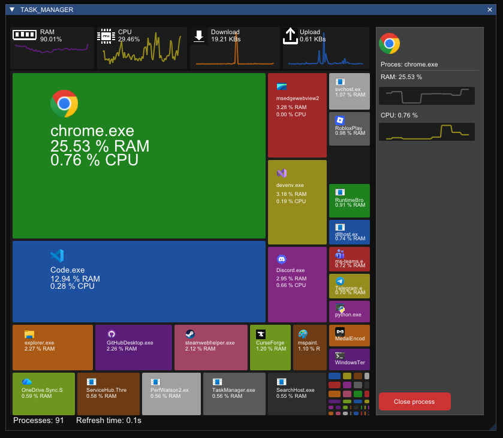

# Task Manager

A lightweight Windows task manager written in C++ with Dear ImGui and DirectX 11. Instead of a plain list of processes, it shows them as a treemap every process is a tile, size of the tile reflects how much RAM it uses.



## Features

- RAM usage, CPU usage, download speed and upload speed, each with a small history graph.
- Treemap of all running processes. Larger tiles use more RAM
- Details panel on the right. Click a process to see its icon, name, RAM and CPU usage with live graphs.
- "Close process" button to terminate the selected process.Silver bullet close

## Requirements

- Windows 10 or Windows 11 (64-bit)
- A graphics card and driver with DirectX 11 support

## How to run (pre-built version)

1. Go to the **Releases** section of this repository.
2. Download the latest `.zip` file from the **Assets** list.
3. Extract the whole archive to a folder. Do not run the program from inside the zip file, because it needs the image files that are stored next to the executable.
4. Run `example_win32_directx11.exe`.

Windows SmartScreen may show a warning because the program is not digitally signed. Click **More info**, then **Run anyway**.

Some actions, such as closing processes that belong to other users or to the system, may require running the program as administrator.

## How to build from source

Requirements:

- Visual Studio 2022 (Community edition is enough)
- The "Desktop development with C++" workload
- Windows SDK

Steps:

1. Clone the repository:
   ```
   git clone <repository-url>
   ```
2. Open the `.sln` file in Visual Studio.
3. Set the configuration to **Release** and the platform to **x64**.
4. Build the solution (Ctrl+Shift+B).
5. The executable will be created in `x64\Release`. Copy the image files (`.png`, `.jpg`) and `imgui.ini` from the project folder next to the executable if you want to run it outside of Visual Studio.

## Technologies

- C++
- Dear ImGui
- DirectX 11
- Windows API
